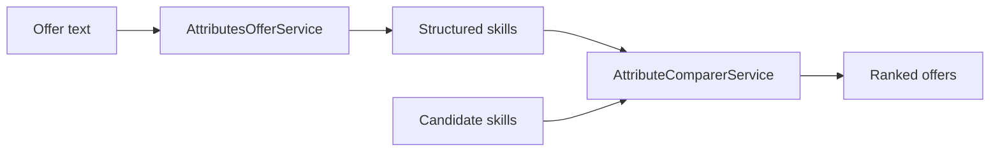

# JobSeek

Fit a candidate to job offers. The part that runs today extracts skills from an offer with a language model, checks that output before it would be trusted, and scores the offer against the candidate in plain C#.

There is no web form, CV upload, or chat yet. Those are listed under [Roadmap](#roadmap).

## What works today

| Piece | What it does |
|---|---|
| `AttributesOfferService` | Sends the offer text to the model and reads skills back as a fixed structure. Temperature is 0. |
| Release tests | The same offers go through the model. Must-have and Should-have rules block a release. A Nice-to-have miss is a known limit. |
| `AttributeComparerService` | Scores a candidate against an offer. Required skills count for 0.8, nice-to-have skills for 0.2. |
| `CategoryOfferService` | Maps a parsed offer onto the fields the comparer uses. |
| `SkillConsolidationService` | Collapses extracted skill names that mean the same thing into one master list. |
| `JobSeek.Sandbox` | Console entry point for the programs above. |

Stack: .NET 10, C#, ASP.NET-style contracts, `Microsoft.Extensions.AI`, OpenAI structured output.



## Run the offline tests

These tests do not call a model.

```powershell
dotnet test
```

`JobSeek.runsettings` excludes `TestCategory=Llm`.

## Run the release tests

These tests spend tokens and can change when the model changes. Set `OPENAI_JOBSEEK_API_KEY`. `LLM_MODEL` defaults to `gpt-4o-mini`.

```powershell
$env:LLM_MODEL = "gpt-4o-mini"
dotnet test Tests/JobSeek.Prompter.Services.ReleaseTests --filter "TestCategory=Llm"
```

Each model writes a card under `Tests/JobSeek.Prompter.Services.ReleaseTests/Leaderboard/`. The latest run of one model replaces only that model's file. [summary.md](Tests/JobSeek.Prompter.Services.ReleaseTests/Leaderboard/summary.md) keeps one row per model.

A failed Must-have or Should-have check means the model is not ready to ship. A failed Nice-to-have check does not block the release by itself.

- **Must have.** The result is safe to store. The offer id comes back, a skill already tagged on the offer keeps its name, level, and list, and a technology named in the offer lands on required or nice-to-have.
- **Should have.** The result stays technical. Benefits, soft traits, and spoken languages stay out. A skill that is only named is not treated as senior. A technology that was not pre-tagged is still extracted.
- **Nice to have.** The wording is harder: "senior expert", Polish text returned as English skill names, negation, and a long offer with many buried skills.

Latest run, 2026-10-07:

| Model | Passed/Total | Release gate | Known gap |
|---|---|---|---|
| gpt-4o-mini | 15/16 | Must and Should passed | Dense offer, NH-06 |
| gpt-4.1-nano | 14/16 | Must and Should passed | Dense offer, NH-06, and negation, NH-05 |

On these runs, `gpt-4o-mini` is the stronger model to ship. Cards: [gpt-4o-mini](Tests/JobSeek.Prompter.Services.ReleaseTests/Leaderboard/gpt-4o-mini.md), [gpt-4.1-nano](Tests/JobSeek.Prompter.Services.ReleaseTests/Leaderboard/gpt-4.1-nano.md).

## Run the sandbox

From the repository root:

```powershell
dotnet run --project JobSeek.Sandbox -- --help
dotnet run --project JobSeek.Sandbox -- prompter --help
dotnet run --project JobSeek.Sandbox -- comparator --help
dotnet run --project JobSeek.Sandbox -- categorizator --help
dotnet run --project JobSeek.Sandbox -- normalizator --help
```

`prompter` needs `OPENAI_JOBSEEK_API_KEY`.

## Build the master skill list

`normalizator` reads required and nice-to-have skill names from `data/offer-attributes.json` and writes `data/skill-master-list.json`.

```powershell
dotnet run --project JobSeek.Sandbox -- normalizator
```

Run it from the repository root. Before consolidation the extracted names were 596 separate skills. After the normalizator, `data/skill-master-list.json` has 306.

Two local embedding models were scored on the same pairs. Names that should become one skill: `javascript` / `js`, `unit tests` / `unit testing`, and Polish `bazy relacyjne` / `relational databases`. Names that should stay apart: `java` / `javascript`, `c#` / `c++`, and `react` / `kubernetes`. `multilingual-e5-small` gave high scores to unrelated skills as well as to aliases, so one cutoff could not both merge the aliases and keep Java apart from JavaScript. `paraphrase-multilingual-MiniLM-L12-v2` leaves a gap between those groups. The cutoff is 0.57.

## Download the embedding model

The model files are not in the repo. `JobSeek.Normalizator.Services/Models/` is gitignored, so download them once on each machine. From the repository root:

```powershell
$dir = "JobSeek.Normalizator.Services/Models/paraphrase-multilingual-MiniLM-L12-v2"
New-Item -ItemType Directory -Force -Path $dir | Out-Null
Invoke-WebRequest -Uri "https://huggingface.co/sentence-transformers/paraphrase-multilingual-MiniLM-L12-v2/resolve/main/sentencepiece.bpe.model" -OutFile "$dir/sentencepiece.bpe.model"
Invoke-WebRequest -Uri "https://huggingface.co/Xenova/paraphrase-multilingual-MiniLM-L12-v2/resolve/main/onnx/model_quantized.onnx" -OutFile "$dir/model.onnx"
```

Save the quantized ONNX file as `model.onnx`. The normalizator and its unit tests look for `model.onnx` and `sentencepiece.bpe.model`.

## Layout

```text
JobSeek.Categorizator.Contracts / Services   offer and candidate models, mapping
JobSeek.Prompter.Contracts / Services        structured skill extraction
JobSeek.Comparator.Contracts / Services      ranking
JobSeek.Normalizator.Contracts / Services    master skill list
JobSeek.Sandbox                              console runner
Tests/JobSeek.Comparator.Services.UnitTests  offline ranking tests
Tests/JobSeek.Normalizator.Services.UnitTests offline consolidation and normalization tests
Tests/JobSeek.Prompter.Services.ReleaseTests ship / no-ship checks
```

## Roadmap

Not built yet.

1. A candidate enters a profile and receives ranked offers.
2. A candidate uploads a CV and receives ranked offers.
3. A candidate talks to an agent that narrows the offers.
4. The best 10–15 offers get a short written explanation from the model.

Saved offer text is what the tests use today. A live source of offers is not chosen yet.
