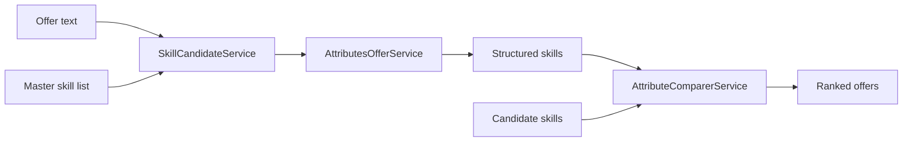

# JobSeek

Fit a candidate to job offers. The part that runs today extracts skills from an offer with a language model, checks that output before it would be trusted, and scores the offer against the candidate in plain C#.

There is no web form, CV upload, or chat yet. Those are listed under [Roadmap](#roadmap).

## What works today

| Piece | What it does |
|---|---|
| `SkillCandidateService` | Builds a short skill list for one offer from the master list. BM25 and local embeddings are fused with reciprocal rank fusion. The paid model is not used. |
| `AttributesOfferService` | `ExtractAttributes` sends that short list as a strict enum. The call is cancelled after 45 seconds and is not retried. A skill that is not in the enum is left out. `ExtractRawAttributes` has no strict grammar: `skill_name` is an allowed value, and `skill_raw` is a technical skill that is not on the list. Temperature is 0. The sandbox calls `ExtractAttributes`. |
| Release tests | The same offers go through the model. Must-have and Should-have rules block a release. A Nice-to-have miss is a known limit. |
| `AttributeComparerService` | Scores a candidate against an offer. Required skills count for 0.8, nice-to-have skills for 0.2. |
| `CategoryOfferService` | Maps a parsed offer onto the fields the comparer uses. |
| `SkillConsolidationService` | Collapses extracted skill names that mean the same thing into one master list. |
| `JobSeek.Sandbox` | Console entry point for the programs above. |

Stack: .NET 10, C#, ASP.NET-style contracts, `Microsoft.Extensions.AI`, OpenAI structured output.



## Run the offline tests

These tests do not call a model.

```powershell
dotnet test
```

`JobSeek.runsettings` excludes `TestCategory=Llm`.

## Run the release tests

These tests spend tokens and can change when the model changes. Set `OPENAI_JOBSEEK_API_KEY`. `LLM_MODEL` defaults to `gpt-4o-mini`.

```powershell
$env:LLM_MODEL = "gpt-4o-mini"
dotnet test Tests/JobSeek.Prompter.Services.ReleaseTests --filter "TestCategory=Llm&TestCategory!=Freeform"
```

That run calls `ExtractAttributes` with the master list declared in the tests. The older freeform tests stay in the project for comparison and do not run with that filter. Run them on their own; a freeform run replaces the same model card.

```powershell
dotnet test Tests/JobSeek.Prompter.Services.ReleaseTests --filter "TestCategory=Freeform"
```

Each model writes a card under `Tests/JobSeek.Prompter.Services.ReleaseTests/Leaderboard/`. The latest run of one model replaces only that model's file. [summary.md](Tests/JobSeek.Prompter.Services.ReleaseTests/Leaderboard/summary.md) keeps one row per model.

A failed Must-have or Should-have check means the model is not ready to ship. A failed Nice-to-have check does not block the release by itself.

- **Must have.** The result is safe to store. The offer id comes back, a skill already tagged on the offer keeps its name, level, and list, and a technology named in the offer lands on required or nice-to-have when it is on the master list. A technology that is not on that list is left out.
- **Should have.** The result stays technical. Benefits, soft traits, and spoken languages stay out. A skill that is only named is not treated as senior. A technology that was not pre-tagged is still extracted.
- **Nice to have.** The wording is harder: "senior expert", Polish text returned as English skill names, negation, and a long offer with many buried skills.

Latest master-list run, 2026-10-14:

| Model | Passed/Total | Release gate | Known gap |
|---|---|---|---|
| gpt-4o-mini | 14/16 | Must and Should passed | Negation, NH-05, and the buried offer, NH-06 |

On this run, `gpt-4o-mini` passes the release gate. Card: [gpt-4o-mini](Tests/JobSeek.Prompter.Services.ReleaseTests/Leaderboard/gpt-4o-mini.md).

The [gpt-4.1-nano](Tests/JobSeek.Prompter.Services.ReleaseTests/Leaderboard/gpt-4.1-nano.md) card is the freeform run from 2026-10-07 (14/16). It is not part of this master-list run.

## Run the sandbox

From the repository root:

```powershell
dotnet run --project JobSeek.Sandbox -- --help
dotnet run --project JobSeek.Sandbox -- prompter --help
dotnet run --project JobSeek.Sandbox -- comparator --help
dotnet run --project JobSeek.Sandbox -- categorizator --help
dotnet run --project JobSeek.Sandbox -- normalizator --help
```

`prompter` needs `OPENAI_JOBSEEK_API_KEY`. It reads `data/offers.json` and `data/skill-master-list.json`, builds the local shortlist, and writes `data/offer-master-strict-attributes.json`. An offer already saved with a missing or true `isResponseValid` is skipped. A timeout or any other exception is saved with the static skills and `isResponseValid` false, and the next run tries that offer again. When an offer has no candidate skills, the static skills are saved and the model is not called.

To run the raw path, change the `ExtractAttributes` call in `PrompterProgram` to `ExtractRawAttributes` and set `--output`, for example `data/offer-master-raw-attributes.json`.

## Build the master skill list

`normalizator` reads required and nice-to-have skill names from `data/offer-attributes.json` and writes `data/skill-master-list.json`.

```powershell
dotnet run --project JobSeek.Sandbox -- normalizator
```

Run it from the repository root. Before consolidation the extracted names were 596 separate skills. After the normalizator, `data/skill-master-list.json` has 306.

Two local embedding models were scored on the same pairs. Names that should become one skill: `javascript` / `js`, `unit tests` / `unit testing`, and Polish `bazy relacyjne` / `relational databases`. Names that should stay apart: `java` / `javascript`, `c#` / `c++`, and `react` / `kubernetes`. `multilingual-e5-small` gave high scores to unrelated skills as well as to aliases, so one cutoff could not both merge the aliases and keep Java apart from JavaScript. `paraphrase-multilingual-MiniLM-L12-v2` leaves a gap between those groups. The cutoff is 0.57.

`prompter` does not send all 306 names to the paid model. `SkillCandidateService` first picks at most 30 of them on this machine. Offer skills and candidate skills still share the master list, which is what the comparer matches on.

### Select 30 skills locally

The shortlist is built from two searches. The paid model is called only after that list exists.

**BM25.** The offer text is the document. A master skill scores when its words appear together, in order. `entity framework` counts. The same words in different sentences do not. An alias such as `dotnet` scores as `.NET`.

**Embeddings.** The local MiniLM model embeds the 306 master names once, at startup. Short stretches of the offer, one to three words long, are embedded the same way and compared with those vectors. A stretch is kept when its cosine with a master name is at least 0.90.

**RRF.** Reciprocal rank fusion merges the two ranked lists, with the constant `k = 60`. A skill on both lists scores `1/(60 + BM25 rank) + 1/(60 + embedding rank)`. A BM25 hit is kept even when the list is already at 30. Embedding-only names fill the places that remain, highest fused score first, and the list stops at 30.

## Cost optimization

`gpt-4o-mini` bills input at $0.15 per million tokens. A later request that starts with the same tokens reuses that prefix: the first cache step is 1,024 tokens, and further steps are 128 tokens. Cached tokens cost $0.075 per million. The user message is billed at the full input price on every offer.

### 1. Keep offer-specific text in the user message

The response schema and the system prompt are shared by every offer. For the current master list of 306 skills the schema is 2,793 tokens. The system prompt is about 700 tokens. The shared prefix is 2,793 + 700 = **3,493** tokens.

Tagged skills and the raw description change on every offer. `OfferAttributesPrompt.User` carries both. The system prompt stays the same from offer to offer, so those 3,493 tokens can be cached. Offer-specific text in the system prompt ends the identical prefix at that point, and the tokens after it are billed at $0.15 per million.

A cache hit is counted in whole steps of 128. 3,493 ÷ 128 is 27 steps plus a remainder:

- 27 × 128 = **3,456** tokens at the cached price
- 3,493 − 3,456 = **37** tokens at the normal input price

Cached tokens count as half a token in the bill. A hit on this prefix is billed as 3,456 × 0.5 + 37 = **1,765** token-equivalents.

| Shared prefix | Full-price tokens | Cached tokens | Billed as | Price |
|---|---:|---:|---:|---:|
| Changes with the offer | 3,493 | 0 | 3,493 | $0.000524 |
| Cache hit | 37 | 3,456 | 1,765 | $0.000265 |

The prices are 3,493 / 1,000,000 × $0.15 = $0.00052395, and 3,456 / 1,000,000 × $0.075 + 37 / 1,000,000 × $0.15 = $0.00026475.

The user message is about **700** tokens. It contains the static required and nice-to-have skills plus the job description, and those tokens change every offer, so they are billed at $0.15 per million on every call.

| User message | Full input | Cache-hit input | Billed as | Price, no cache | Price, hit | Cut |
|---|---:|---:|---:|---:|---:|---:|
| 700 | 4,193 | 700 + 1,765 | 2,465 | $0.000629 | $0.000370 | **41.2%** |

That is **1,728** token-equivalents less ($0.000259 per offer). One thousand cache hits cost about **$0.26** less ($0.629 versus $0.370). The first offer in a run pays the full prefix price and fills the cache.

### 2. Define the skill schema once

The master-list schema used to write the skill object, including the 306-name enum, under both `required_skills` and `nice_to_have_skills`. `AttributesOfferService` now stores that object in `$defs` and both arrays use `{ "$ref": "#/$defs/skill" }`.

Measured input tokens for the same kind of call:

| Schema | Input tokens | Price at $0.15 / 1M |
|---|---:|---:|
| Enum inlined twice | 4,750 | $0.000713 |
| Shared `$ref` | 3,291 | $0.000494 |

That is **1,459** fewer input tokens, **30.7%**. At the full input price the cut is 1,459 / 1,000,000 × $0.15 = **$0.000219** per offer. One thousand offers cost about **$0.22** less ($0.713 versus $0.494).

This cut is on the request size, so it applies to the first offer in a run as well as to later ones. The cache figures above use a 2,793-token schema from before this change. They need a new split of schema, system prompt, and user message before they match the 3,291-token call.

### 3. Define the shortlist as the enum

`prompter` used to put all 306 master names in `skill_name`. `SkillCandidateService` now picks at most 30 names locally, and `ExtractAttributes` writes those names as the enum inside `$defs/skill`. Both arrays still use `{ "$ref": "#/$defs/skill" }`.

The enum is the large part of the schema, so 30 names are a smaller request than 306. That cut applies to the first offer in a run and to later ones. Strict mode compiles a grammar from that enum, which is why the strict call is cancelled after 45 seconds. The token tables in points 1 and 2 were measured on the 306-name schema.

## Download the embedding model

The model files are not in the repo. `JobSeek.Normalizator.Services/Models/` is gitignored, so download them once on each machine. From the repository root:

```powershell
$dir = "JobSeek.Normalizator.Services/Models/paraphrase-multilingual-MiniLM-L12-v2"
New-Item -ItemType Directory -Force -Path $dir | Out-Null
Invoke-WebRequest -Uri "https://huggingface.co/sentence-transformers/paraphrase-multilingual-MiniLM-L12-v2/resolve/main/sentencepiece.bpe.model" -OutFile "$dir/sentencepiece.bpe.model"
Invoke-WebRequest -Uri "https://huggingface.co/Xenova/paraphrase-multilingual-MiniLM-L12-v2/resolve/main/onnx/model_quantized.onnx" -OutFile "$dir/model.onnx"
```

Save the quantized ONNX file as `model.onnx`. The normalizator and its unit tests look for `model.onnx` and `sentencepiece.bpe.model`.

## Layout

```text
JobSeek.Categorizator.Contracts / Services   offer and candidate models, mapping
JobSeek.Prompter.Contracts / Services        structured skill extraction
JobSeek.Comparator.Contracts / Services      ranking
JobSeek.Normalizator.Contracts / Services    master skill list and per-offer shortlist
JobSeek.Sandbox                              console runner
Tests/JobSeek.Comparator.Services.UnitTests  offline ranking tests
Tests/JobSeek.Normalizator.Services.UnitTests offline consolidation and normalization tests
Tests/JobSeek.Prompter.Services.ReleaseTests ship / no-ship checks
```

## Roadmap

Not built yet.

1. A candidate enters a profile and receives ranked offers.
2. A candidate uploads a CV and receives ranked offers.
3. A candidate talks to an agent that narrows the offers.
4. The best 10–15 offers get a short written explanation from the model.

Saved offer text is what the tests use today. A live source of offers is not chosen yet.
